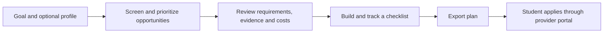
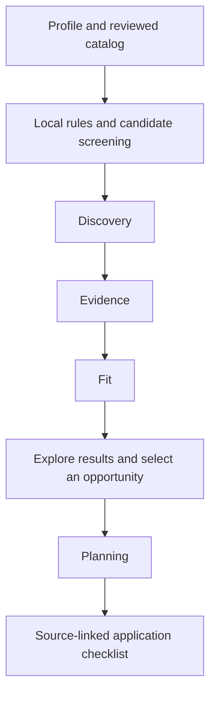

# Equal Start

**Find U.S. undergraduate scholarships and funded experiences, understand the requirements, and turn an opportunity into an application plan.**

Students without a professional network or money to cover upfront expenses can miss opportunities they are qualified to pursue. Equal Start brings discovery, source-linked requirements, financial barriers, and application preparation into one place.

The app combines a custom Streamlit interface with predictable eligibility rules and four specialist AI agents. It currently includes **20 reviewed U.S. opportunities**, covering scholarships, transfer funding, and funded research experiences. Some archived cycles are retained to demonstrate deadline handling.

[Quick start](#quick-start) · [How it works](#how-it-works) · [Agent evaluations](#agent-evaluations) · [Project structure](#project-structure) · [Contributing](#contributing)

## What students can do

- Describe a goal and optionally add details such as year of study, institution type, GPA, and citizenship or residency.
- Explore opportunities with clear eligibility outcomes, application dates, funding evidence, and source links.
- Identify reimbursement delays, housing gaps, and other costs before committing to an experience.
- Build a source-linked checklist, track preparation, and download a plan as JSON or Markdown.

**Example:** A community-college student wants a funded research experience but cannot pay for travel upfront. Equal Start screens recorded requirements, prioritizes relevant options, and surfaces reimbursement or housing concerns. The student can then confirm unresolved conditions with the provider and prepare the required documents.

## Quick start

Python 3.13 was used for the verified build. Run these commands from the repository root.

### Windows PowerShell

```powershell
git clone https://github.com/vineelad/equalstart.git
cd equalstart
python -m venv .venv
.\.venv\Scripts\python.exe -m pip install -r requirements.lock.txt
Copy-Item .env.example .env
.\.venv\Scripts\python.exe -m streamlit run app.py
```

### macOS or Linux

```bash
git clone https://github.com/vineelad/equalstart.git
cd equalstart
python3 -m venv .venv
.venv/bin/python -m pip install -r requirements.lock.txt
cp .env.example .env
.venv/bin/python -m streamlit run app.py
```

Open **http://127.0.0.1:8501**. Select **Try Maya's sample profile** for a fictional student journey that works without model credentials. The sample uses explicitly labeled local matching.

Create `.env` only once; preserve an existing configured file. On Windows, subsequent launches can use `./run.ps1`.

### Enable live services

Edit your local `.env` with your own provider keys:

| Setting | Purpose |
| --- | --- |
| `FIREWORKS_API_KEY` | Enables structured model calls for the four specialist roles. |
| `KEENABLE_API_KEY` | Enables authenticated opportunity search and source retrieval. |
| `FIREWORKS_MODEL` | Defaults to `accounts/fireworks/models/gpt-oss-120b`. |
| `INFERENCE_BUDGET_USD` | Sets the cumulative inference cap for this local database, up to $15. |
| `FIREWORKS_INPUT_PER_MILLION`, `FIREWORKS_OUTPUT_PER_MILLION` | Optional for the default model, which has built-in rates; required for custom models. |

Restart after changing provider settings. Open **How it works → Demo settings** to inspect live-mode settings and budget usage, then submit your own profile from Explore. Keys remain server-side and `.env` is ignored by Git.

## How it works

This walkthrough contains the eight flows from the team's diagram handout. Each section explains a part of the implemented system and includes its full diagram.

**Diagram resources:** [PDF handout](docs/diagrams/equalstart-flow-diagrams.pdf) · [Offline viewer](docs/diagrams/index.html) · [Editable Mermaid sources and SVGs](docs/diagrams/). Download the repo and open the HTML viewer locally to browse offline or print. In the diagrams, solid arrows show execution or data movement, dotted arrows show optional connections or controls, and cylinders indicate local storage.

### 1. Student journey

Start with a goal or the fictional sample, explore the reviewed catalog, inspect a record, and build an application checklist. Students can filter results and revisit saved plans. Submission takes place through the official provider portal.



<details>
<summary>View the full student journey</summary>


</details>

### 2. System architecture and data boundaries

The Streamlit app validates the student's input and loads the reviewed JSON catalog. Python rules assess eligibility, dates, and financial barriers. LangGraph coordinates matching, while Fireworks provides structured model responses and Keenable provides search and source retrieval.

| Component | Responsibility |
| --- | --- |
| Streamlit + custom CSS | Explore, opportunity details, saved plans, and workflow visibility. |
| Pydantic | Validate profiles, catalog records, and model output schemas. |
| Python rules | Determine recorded eligibility outcomes, cycle status, financial barriers, and local relevance scores. |
| LangGraph | Run Discovery, Evidence, and Fit in sequence with shared state. |
| Fireworks | Run the bounded specialist prompts using an open-weight model. |
| Keenable | Search for separate web leads and retrieve approved provider URLs. |
| SQLite | Persist checklist state, concise stage metadata, and cumulative cost reservations. |

Profiles remain in session memory. Fireworks receives the context needed for each role; Keenable discovery receives a broad discipline query. Saved plans contain opportunity IDs, checklist content/order, and completion state rather than a full student profile.

<details>
<summary>View the system and data boundaries</summary>


</details>

### 3. The four agents and their handoffs

Matching begins with deterministic checks across the catalog. Known failures and closed cycles are excluded from agent inputs; up to 12 candidates proceed to the graph.



| Agent | What it receives | What it returns | Boundary |
| --- | --- | --- | --- |
| **Discovery** | Goal, discipline, reviewed candidates, and optional unverified search leads. | Relevant supplied catalog IDs in priority order. | Cannot create candidate IDs or promote a web lead into a reviewed record. |
| **Evidence** | Stored claim summaries for selected opportunities. | Existing claim IDs that need clarity review. | Screens ambiguity; does not independently verify webpages. |
| **Fit** | Goal, cost/housing constraints, candidate scores, and known barriers. | Every selected opportunity ID, reordered. | Cannot override hard eligibility results or change the candidate set. |
| **Planning** | A selected opportunity's published materials. | Every material index in a preparation order. | Cannot invent or remove published requirements. |

The LangGraph matching workflow has **three sequential nodes**: Discovery → Evidence → Fit. Planning runs separately when a student builds a checklist. The result list prioritizes selected IDs while retaining the other catalog outcomes for browsing and filtering.

Without live inference, Discovery keeps screened candidates, Evidence adds no model flags, Fit uses local scores, and Planning keeps source order. A model or validation failure records a visible **Fallback** event and retains the corresponding local result. Valid empty inputs do not make model calls.

<details>
<summary>View the full matching graph and agent handoffs</summary>


</details>

### 4. Eligibility, dates, and financial fit

Eligibility uses three outcomes so missing information stays visible:

| Outcome | Meaning |
| --- | --- |
| **Not eligible** | At least one known recorded requirement is not met. |
| **Needs confirmation** | A profile detail is missing or an additional provider condition remains unresolved. |
| **Screened criteria met** | All modeled checks pass and no recorded confirmation item remains. |

Cycle status is evaluated separately using available dates and timezones. A date-only deadline retains uncertainty about the closing time. Known failures and closed cycles are excluded from the default results view.

Financial fit includes payment timing and housing. Reimbursed travel can still require upfront money, and unknown costs remain uncertain. The local relevance score combines goal fit (up to 40), funding evidence (30), known criteria (20), and constraints (10). It is a prioritization heuristic, not an acceptance probability.

<details>
<summary>View the eligibility and relevance flow</summary>


</details>

### 5. Source provenance and review

The reviewed catalog is built from official provider pages. Each claim carries a source URL, topic, and review date. Reviewed summaries and rules are validated before they appear as opportunity records.

Keenable search returns up to five separate, **unverified leads**. Source refresh retrieves text from an approved HTTPS provider URL for inspection. Neither search nor refresh silently changes catalog facts; a manual review is required before new facts enter the catalog. Extracted text can omit page sections, so complete conditions still need confirmation with the provider.

<details>
<summary>View the source review and catalog flow</summary>


</details>

### 6. Model validation, spending controls, and fallback

Every model request uses a role-specific JSON schema. Returned references must belong to the supplied input and contain no duplicates. Discovery and Evidence can select subsets; Fit and Planning must preserve every input reference exactly once.

Before sending a request, the app estimates a conservative cost and reserves it in an atomic SQLite transaction. If the reservation exceeds the remaining budget, the request is blocked and the stage uses its local fallback. Returned token usage settles the estimate; missing usage or an ambiguous network failure retains the reservation.

The application cap is cumulative for calls recorded in that database, including evaluations, and cannot exceed **$15**. It cannot track other machines or applications on the provider account. Clearing saved plans preserves the ledger; deleting the database loses its usage history. Keenable credits are separate from the inference ledger.

<details>
<summary>View the model request, budget, and fallback flow</summary>


</details>

### 7. Planning and saved progress

For a selected opportunity, Planning orders explicit zero-based material indices. The app checks that every original index appears exactly once, then builds tasks using the unchanged requirement text and source links. If the model fails, the published source order is preserved.

General preparation steps—rechecking eligibility, confirming costs, and reviewing before submission—are labeled separately from published requirements. SQLite preserves the checklist and completed task IDs so the student can return to the plan and export it.

<details>
<summary>View planning and persistence</summary>


</details>

### 8. Evaluation and evidence

Each specialist has a dedicated quality evaluation suite using the **same production prompts, schemas, and identifier guards** as the app. Expected labels are kept out of model requests, and deterministic graders compare outputs against those labels.

The suite contains 32 synthetic cases: eight per agent. With three repeats, a paired run records 96 live-mode case results and 96 local-baseline results. The live side makes 84 model calls; the remaining 12 cases exercise empty-input guards without a call.

<details>
<summary>View the evaluation flow</summary>


</details>

## Agent evaluations

| Agent | Task-quality check | Recorded final live result |
| --- | --- | --- |
| Discovery | Relevant-ID precision and recall of at least 0.80 per case. | 24/24 cases passed. |
| Evidence | Ambiguity-flag F1 of at least 0.80 per case. | 24/24 cases passed. |
| Fit | All labeled preference pairs correctly ordered, with every candidate preserved. | 24/24 cases passed. |
| Planning | All labeled prerequisite pairs correctly ordered, with every material preserved. | 24/24 cases passed. |

Each live agent must achieve **100% contract validity** and **at least 90% task-case passes** to pass its gate. The recorded final run met both gates for every agent. Contract failures count as failed cases. The runner also records latency, cost, diagnostic quality metrics, and repeat stability.

These are small synthetic development cases used during prompt refinement. The results demonstrate behavior on that regression suite; they do not establish held-out real-world accuracy or scholarship selection outcomes. Earlier failed runs are retained alongside the final run.

See the [evaluation guide](evals/README.txt), [recorded final report](docs/evals/20261103T025831998872Z/REPORT.txt), and [all run artifacts](docs/evals/). Download the repo to open the standalone HTML dashboards in a browser.

### Run checks locally

```powershell
# Development dependencies and deterministic tests; no live inference required.
.\.venv\Scripts\python.exe -m pip install -r requirements-dev.lock.txt
.\.venv\Scripts\python.exe -m pytest -q

# Baseline evaluation only; no inference charges.
.\.venv\Scripts\python.exe -m evals.runner

# Paired live and baseline evaluation; requires configured model access.
.\.venv\Scripts\python.exe -m evals.runner --live --repeats 3 --max-cost 1
```

Use `.venv/bin/python` on macOS/Linux. The latest verified deterministic suite has **68 passing tests**. Live evaluations use the same cumulative budget ledger with the specified smaller run cap. Reports are written to a unique folder under `docs/evals/`; a failed live gate returns a nonzero exit code and still preserves its results.

## Project structure

```text
app.py                    Streamlit pages and student interactions
equalstart/
  workflow.py             Matching graph and on-demand checklist planning
  agents.py               Shared prompts, output schemas, and reference guards
  eligibility.py          Eligibility rules, cycle status, barriers, and scoring
  providers.py            Fireworks and Keenable clients
  schema.py               Pydantic models
  storage.py              SQLite plans, stage metadata, and budget ledger
  catalog.py              Catalog loading and validation
  design.css              Custom interface styling
data/opportunities.json   Reviewed opportunity records and evidence
evals/                    Fixed cases, deterministic graders, and evaluation runner
tests/                    Rule, contract, storage, and UI regression checks
docs/diagrams/            Flow diagrams, offline viewer, and PDF handout
docs/evals/               Recorded evaluation runs and dashboards
scripts/                  Catalog seeding, source refresh, and browser checks
```

## Contributing

Fork the repository, create a branch, and open a pull request against `main`. Include what changed, why it helps students, and the checks you ran.

- **Catalog changes:** confirm facts on the official provider page, update source links and review dates, and preserve uncertainty where conditions are incomplete. `scripts/seed_catalog.py` rebuilds the catalog; `scripts/refresh_sources.py` retrieves reviewed URLs for inspection.
- **Agent changes:** run contract tests and the relevant evaluations. Preserve prior results so reviewers can compare behavior. Live checks incur inference usage.
- **UI changes:** exercise the profile → results → details → checklist journey. `scripts/browser_check.py` supports browser checks with a running local server and installed Microsoft Edge.

Keep keys and personal data in local ignored files. Read the `.env.example` template for supported configuration.

## Current limits and deployment

Equal Start is a **single-user local demo**. The reviewed catalog is limited, eligibility modeling is incomplete, and provider conditions and cycles can change. A student passing the recorded checks may still need to satisfy additional conditions. The app prepares a plan; students verify the complete requirements and submit through the official portal.

For a Python-capable host, install the locked dependencies, configure secrets server-side, provide persistent SQLite storage, and launch Streamlit on the host-assigned port. Before shared personal use, add authentication and storage isolation per user. The repository does not include a hosted deployment.
